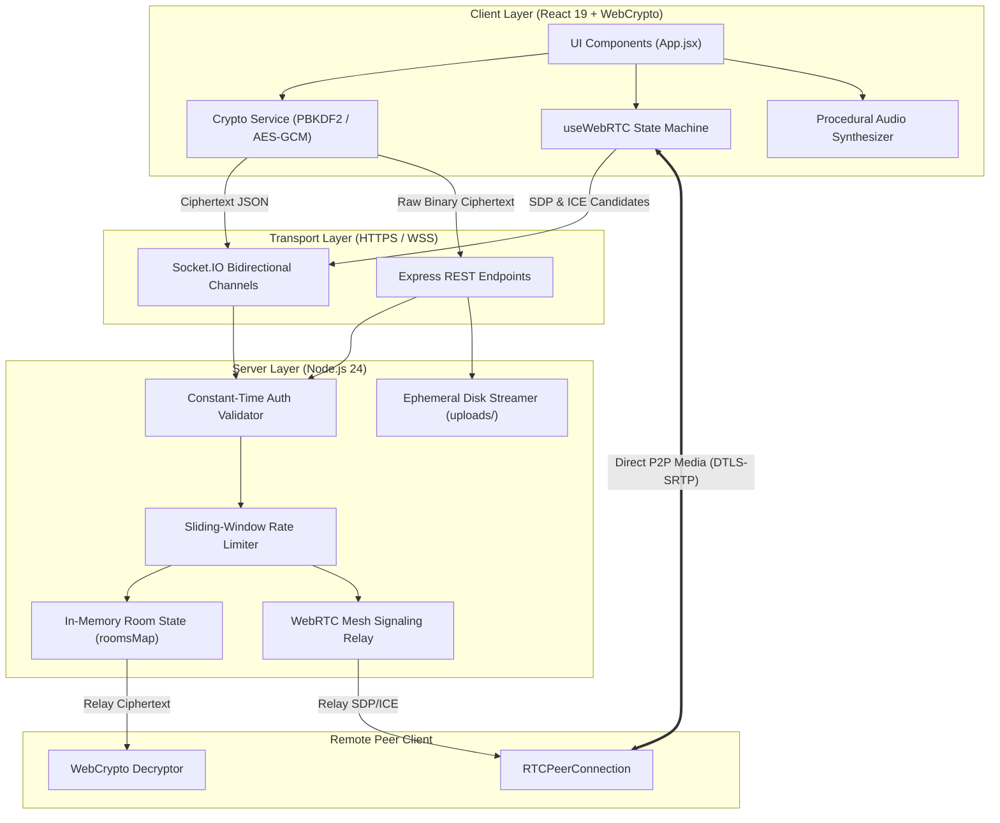

# PROJECT KNOWLEDGE BASE: NijiSamvad (निजी संवाद)

> **Permanent Technical Architecture, Cryptographic Design & System Specification**  
> *Target Audience: Senior Software Engineers, Security Researchers, and Autonomous AI Coding Agents*

---

## A. Project Identity

- **Official Name**: NijiSamvad (Hindi: *निजी संवाद* — "Private Dialogue")
- **Internal System Identifier**: `securechat` (per `package.json`)
- **System Classification**: Zero-Knowledge, Zero-Database, Ephemeral End-to-End Encrypted (E2EE) Real-Time Messaging & WebRTC Multimedia Mesh Platform
- **Problem Being Solved**: Traditional collaboration software retains indefinite plaintext or ciphertext chat logs, attachments, and identity metadata in persistent storage (PostgreSQL, MongoDB, Redis, S3). This architecture exposes users to forensic extraction, subpoena disclosure, data breaches, and server-operator surveillance.
- **Unique Value Proposition**: Complete cryptographic sovereignty. Client devices independently derive encryption keys from client-held secrets using PBKDF2-SHA-256. The server functions purely as an untrusted, unprivileged relay. Neither plaintext, cryptographic keys, nor persistent chat history ever touch disk or database storage. All room metadata and temporary encrypted attachments are purged automatically when the last participant disconnects.
- **Current Development Status**: Production-Ready Single-Instance Platform. Tested and verified across 28 automated security/fuzzing tests and 13 Playwright end-to-end integration tests.

---

## B. Technology Inventory

| Technology | Canonical Version | Purpose & Architectural Responsibility | Codebase Location |
| :--- | :--- | :--- | :--- |
| **Node.js** | `>= 18.0.0` (tested on `24.18.0`) | Backend execution runtime, event-loop handling, buffer streaming | `server/server.js`, `package.json` |
| **Express** | `^5.2.1` | Minimal HTTP server, attachment streaming, static bundle hosting | `server/server.js` |
| **Socket.IO (Server)** | `^4.8.3` | WebSocket event gateway, room multiplexing, WebRTC signaling | `server/server.js` |
| **Socket.IO Client** | `^4.8.3` | Bi-directional client communication, automatic polling fallback | `src/App.jsx`, `tests/` |
| **React** | `^19.2.8` | Declarative UI rendering, concurrent state scheduling | `src/App.jsx`, `src/components/` |
| **React DOM** | `^19.2.8` | DOM reconciliation and built-in XSS text escaping | `src/main.jsx` |
| **Vite** | `^8.2.2` | Frontend build engine, HMR, reverse proxying in development | `vite.config.js` |
| **Helmet** | `^8.3.0` | HTTP security headers (strict CSP, HSTS, X-Content-Type-Options) | `server/server.js` |
| **CORS** | `^2.8.6` | Cross-Origin Resource Sharing control and dynamic validation | `server/server.js` |
| **Web Crypto API** | Native (`SubtleCrypto`) | Hardware-accelerated PBKDF2, AES-256-GCM, SHA-256, secure random | `src/services/crypto.js` |
| **Web Audio API** | Native (`AudioContext`) | Active speaker frequency spectrum analysis and sound synthesis | `src/services/sound.js`, `CallInterface.jsx` |
| **WebRTC API** | Native (`RTCPeerConnection`)| Peer-to-peer audio/video streaming via DTLS-SRTP | `src/hooks/useWebRTC.js` |
| **Lucide React** | `^1.39.0` | Accessible vector icons | `src/components/*.jsx` |
| **Emoji Picker React**| `^4.19.4` | Virtualized client-side emoji selector | `src/components/MessageInput.jsx` |
| **Playwright** | `^1.63.0` | Multi-context E2E testing with fake media device streaming | `playwright.config.js`, `tests/e2e/` |
| **Oxlint** | `^1.79.0` | High-speed Rust-based static linting | `.oxlintrc.json` |
| **Concurrently** | `^10.0.5` | Simultaneous client/server development runner | `package.json` |

---

## C. Complete Architecture & Subsystem Analysis

### 1. High-Level Architecture


### 2. Module Responsibilities
- **Frontend App Core (`src/App.jsx`)**: Coordinates the primary state machine (`messages`, `users`, `toasts`, `callState`), binds WebSocket listeners, enforces object URL memory cleanup, and orchestrates user authentication.
- **Cryptographic Subsystem (`src/services/crypto.js`)**: Encapsulates all interactions with `window.crypto.subtle` and `window.crypto.getRandomValues`. Implements rejection sampling, PBKDF2 key derivation, AES-GCM message encryption, and binary blob encryption.
- **WebRTC Subsystem (`src/hooks/useWebRTC.js`)**: Manages multi-peer `RTCPeerConnection` instances in an $O(N^2)$ mesh. Implements the Perfect Negotiation pattern (polite/impolite glare handling), ICE candidate queues, and track replacement for screen sharing.
- **Audio Visualizer & Speaker Detection (`src/components/CallInterface.jsx`)**: Creates an `AudioContext` media stream source for each participant, runs frequency analysis via `AnalyserNode.getByteFrequencyData`, and computes volume thresholds with a 200 ms debounce window.
- **Backend Relay (`server/server.js`)**: Manages socket connections, enforces payload size boundaries (`LIMITS`), validates credentials using constant-time buffers, coordinates ephemeral room destruction, and handles graceful shutdown signals.

---

## D. Feature Documentation

### 1. Zero-Knowledge Cryptographic Key Derivation
- **Mechanism**: The user provides a `userName`, `roomName`, and `roomSecret`. In `src/services/crypto.js`, `deriveKeys(secret, roomName)` executes two parallel derivations using PBKDF2:
  - Key material imported from `secret` with salt `"encryption_salt_" + roomName`, 100,000 iterations, SHA-256 $\to$ derived as non-extractable 256-bit AES-GCM CryptoKey.
  - Key material imported from `secret` with salt `"auth_salt_" + roomName`, 100,000 iterations, SHA-256 $\to$ derived as 256-bit raw bits formatted as a 64-character hexadecimal string (`authHash`).
- **Security Guarantee**: Because different salts are applied and PBKDF2 is computationally non-reversible, exposure of `authHash` gives an attacker (or rogue server administrator) zero mathematical advantage in determining `encryptionKey`.

### 2. End-to-End Encrypted Messaging
- **Mechanism**: Plaintext is wrapped in a versioned envelope:
  ```json
  {
    "version": 1,
    "type": "text",
    "text": "Hello world",
    "replyTo": { "messageId": "msg_123", "senderName": "Alice", "preview": "Hi" },
    "mentions": [{ "id": "socket_456", "username": "Bob" }]
  }
  ```
- **Encryption**: The JSON string is encoded to `Uint8Array` via `TextEncoder`, encrypted with `encryptionKey` and a fresh 12-byte cryptographically random IV. The output is serialized as:
  ```json
  {
    "iv": "<Base64 12-byte IV>",
    "ciphertext": "<Base64 AES-GCM Ciphertext + 128-bit Auth Tag>"
  }
  ```
- **Relay**: Dispatched to server via `socket.emit('send', { id, content })`. The server attaches sender name and timestamp and broadcasts `socket.to(currentRoom).emit('receive', payload)`.
- **Decryption**: Recipients decrypt using their locally stored `encryptionKey`. If decryption throws (e.g. mismatched room secret), the UI renders a fallback warning: *"Unable to decrypt this message. Your room secret may not match."*

### 3. Ephemeral Encrypted File Attachments
- **Mechanism**:
  1. Client selects a file ($\le 9.5\text{ MB}$).
  2. Client generates an independent, single-use 256-bit AES-GCM symmetric key (`attachmentKey`) and 12-byte IV (`src/services/crypto.js: encryptAttachment`).
  3. The file buffer is encrypted into a binary ciphertext blob.
  4. The client uploads the raw binary stream to `POST /api/attachments` with headers `x-room-name` and `x-auth-hash`.
  5. The server stores the raw bytes at `uploads/<uuid>.bin` and records metadata in `attachmentMeta`.
  6. The client constructs an envelope:
     ```json
     {
       "version": 1,
       "type": "attachment",
       "attachmentId": "<uuid>",
       "name": "photo.png",
       "mimeType": "image/png",
       "size": 1048576,
       "attachmentKey": "<Base64 key>",
       "iv": "<Base64 IV>"
     }
     ```
  7. The envelope is encrypted with the room `encryptionKey` and relayed over Socket.IO.
  8. Recipient decrypts the envelope, downloads the binary blob from `GET /api/attachments/<uuid>`, decrypts the file bytes with `attachmentKey`, and mounts the resulting blob via `URL.createObjectURL()`.

### 4. Interactive Replies and Swipe Gestures
- **Desktop**: Hovering reveals reply action buttons.
- **Mobile Touch**: Pointer events (`onPointerDown`, `onPointerMove`, `onPointerUp`) track horizontal touch delta. Swiping $\ge 50\text{ px}$ triggers `navigator.vibrate(50)` and stages the message into `replyingTo` state.
- **Deep Linking**: Clicking a reply preview block (`.reply-preview-block`) executes `scrollToOriginal()`, smoothly scrolling to the target message ID and applying an animation class (`.highlight-pulse`) for 2 seconds.

### 5. Multi-Party WebRTC Mesh Calling
- **Topology**: Full mesh ($N \times (N - 1) / 2$ connections). Recommended for $\le 6$ users; functional up to 8.
- **Call State Machine**:
  - `idle`: No call active.
  - `outgoing`: Local user initiated `startCall()`, broadcasting `call-invite`.
  - `incoming`: Remote user initiated call; displays `IncomingCallModal`.
  - `connecting`: Invitation accepted; local stream acquired; creating peer connections and SDP offers/answers.
  - `connected`: At least one remote peer connection state is `'connected'`.
  - `ended`: Call terminated; local tracks stopped; peer connections closed and garbage-collected.
- **Glare Resolution**: Implements Perfect Negotiation logic. When an offer collision occurs, the peer with `socket.id < remoteSocketId` is "polite" and yields by rolling back its local description (`setLocalDescription({ type: 'rollback' })`).

---

## E. Database Knowledge: In-Memory Ephemeral Architecture

NijiSamvad deliberately operates **without any persistent database**. 

### 1. In-Memory Data Structures (`server/server.js`)
```javascript
// roomsMap: Map<string, RoomObject>
roomsMap = new Map([
  [
    "roomName",
    {
      authHash: "64-character-hex-string-or-null",
      users: new Map([
        [
          "socketId",
          {
            id: "socketId",
            username: "sanitizedUsername",
            joinedAt: 1730304000000
          }
        ]
      ])
    }
  ]
]);

// attachmentMeta: Map<string, AttachmentMeta>
attachmentMeta = new Map([
  [
    "uuid-v4",
    {
      roomId: "roomName",
      filePath: "/path/to/uploads/uuid-v4.bin",
      createdAt: 1730304000000
    }
  ]
]);

// rateLimitsMap: Map<string, Map<string, RateLimitState>>
rateLimitsMap = new Map([
  [
    "socketId",
    new Map([
      ["send", { count: 1, windowStart: 1730304000000 }],
      ["typing", { count: 3, windowStart: 1730304000000 }],
      ["reaction", { count: 0, windowStart: 1730304000000 }],
      ["webrtc", { count: 12, windowStart: 1730304000000 }]
    ])
  ]
]);
```

### 2. Data Teardown Guarantees
1. **Empty Room Teardown (`destroyRoomIfEmpty`)**:
   ```javascript
   async function destroyRoomIfEmpty(roomName) {
     const room = roomStore.getRoom(roomName);
     if (room && room.users.size === 0) {
       await attachmentStore.deleteRoomAttachments(roomName);
       roomStore.destroyRoom(roomName);
     }
   }
   ```
2. **Boot Sanitation**: On startup, `server.js` synchronously executes `fs.rmSync(uploadsDir, { recursive: true, force: true })` and recreates an empty directory.
3. **Shutdown Sanitation**: Captures `SIGINT` and `SIGTERM` signals to close active socket connections and purge `uploadsDir`.
4. **Orphan Garbage Collector**: An hourly timer (`setInterval`, 3600000 ms) purges any attachments whose room no longer exists in `roomsMap` or whose age exceeds 24 hours.

---

## F. Complete API & WebSocket Protocol Reference

### 1. HTTP REST Endpoints

#### `GET /health`
- **Purpose**: Uptime and health check.
- **Auth**: None.
- **Response `200 OK`**:
  ```json
  { "status": "alive", "uptime": 342.12 }
  ```

#### `GET /api/stats`
- **Purpose**: Node monitoring and room counting.
- **Auth**: Disabled in production unless `ENABLE_LOAD_METRICS=true` (returns `404 Not Found`).
- **Response `200 OK`**:
  ```json
  { "rooms": 4, "users": 12 }
  ```

#### `POST /api/attachments`
- **Purpose**: Uploads client-encrypted binary file.
- **Headers**:
  - `Content-Type: application/octet-stream`
  - `x-room-name: <roomName>`
  - `x-auth-hash: <authHash>`
- **Request Body**: Raw binary buffer (max 10 MB).
- **Validation**: Verifies room exists and `crypto.timingSafeEqual(room.authHash, authHash)`.
- **Response `201 Created`**:
  ```json
  { "id": "8e3c49a0-12ab-4c3e-8f23-90d12e87c014" }
  ```
- **Error Codes**: `400` (Empty or non-buffer), `401` (Unauthorized/missing credential), `500` (I/O failure).

#### `GET /api/attachments/:id`
- **Purpose**: Downloads client-encrypted binary file.
- **Headers**:
  - `x-room-name: <roomName>`
  - `x-auth-hash: <authHash>`
- **Validation**: UUID regex check, attachment room match, timing-safe room auth validation.
- **Headers Returned**:
  - `Content-Type: application/octet-stream`
  - `Cache-Control: no-store, no-cache, must-revalidate, proxy-revalidate`
  - `X-Content-Type-Options: nosniff`
- **Response `200 OK`**: Raw encrypted binary stream.
- **Error Codes**: `401` (Unauthorized), `403` (Room mismatch), `404` (Attachment not found).

---

### 2. Socket.IO Events Reference

| Event Name | Direction | Payload Schema | Validation / Limits |
| :--- | :--- | :--- | :--- |
| `new-user-joined` | Client $\to$ Server | `{ userName: string, roomName: string, authHash?: string }` | Username $\le 50$, Room $\le 100$, AuthHash $\le 256$, HTML tag strip `<>` |
| `join-success` | Server $\to$ Client | `{ username: string, room: string }` | Dispatched on successful room admission |
| `join-error` | Server $\to$ Client | `string` (Error message) | Dispatched on auth or validation failure |
| `user-joined` | Server $\to$ Room | `string` (Username) | Broadcast to existing room members |
| `left` | Server $\to$ Room | `string` (Username) | Broadcast when socket disconnects or leaves |
| `room-users` | Server $\to$ Room | `Array<{ id: string, username: string, joinedAt: number }>` | Current roster of room participants |
| `send` | Client $\to$ Server | `{ id: string, content: string }` | Content $\le 256\text{ KB}$, rate limit: 10 per 5s |
| `receive` | Server $\to$ Room | `{ id: string, message: string, name: string, timestamp: string }` | Broadcast to all room peers except sender |
| `typing` | Client $\to$ Server | `boolean` | Rate limit: 5 per 5s |
| `user-typing` | Server $\to$ Room | `{ user: string, isTyping: boolean }` | Relayed to room peers |
| `message-reaction` | Client $\to$ Server | `{ messageId: string, emoji: string }` | MessageId $\le 100$, Emoji $\le 20$, rate limit: 10 per 5s |
| `reaction-added` | Server $\to$ Room | `{ messageId: string, emoji: string, user: string }` | Relayed to room peers |
| `clear-chat` | Client $\to$ Server | *(none)* | Rate limit: 10 per 5s |
| `chat-cleared` | Server $\to$ Room | `string` (Username of clearer) | Broadcasts history clear command |
| `call-invite` | Client $\to$ Server | *(none)* | Rate limit: 50 per 5s |
| `call-accept` | Client $\to$ Server | `{ targetSocketId: string }` | Validates target socket is in same room |
| `call-decline` | Client $\to$ Server | `{ targetSocketId: string }` | Validates target socket is in same room |
| `call-cancel` | Client $\to$ Server | *(none)* | Broadcast to room |
| `call-ended` | Client $\to$ Server | *(none)* | Broadcast to room |
| `webrtc-offer` | Client $\to$ Server | `{ targetSocketId: string, sdp: object }` | SDP size $\le 20\text{ KB}$, target must be in same room |
| `webrtc-answer` | Client $\to$ Server | `{ targetSocketId: string, sdp: object }` | SDP size $\le 20\text{ KB}$, target must be in same room |
| `webrtc-ice-candidate`| Client $\to$ Server | `{ targetSocketId: string, candidate: object }`| Candidate size $\le 20\text{ KB}$, target in room |
| `leave-room` | Client $\to$ Server | *(none)* | Unlinks socket from room and triggers cleanup |

---

## G. Important Files and Directories

```
Directory / File                        Architectural Role & Scope
-------------------------------------------------------------------------------------------------------------
server/server.js                        The entire backend implementation: Express server, Socket.IO gateway,
                                        ephemeral file manager, rate limiter, and constant-time auth verifier.
src/App.jsx                             Main React component: maintains top-level state (messages, users, modals),
                                        manages Socket.IO event listeners, handles object URL disposal.
src/services/crypto.js                  Core cryptographic library: rejection sampling secret generator, PBKDF2
                                        key derivation, AES-256-GCM message & file encryption, SHA-256 fingerprint.
src/services/sound.js                   Web Audio API procedural sound synthesizer (sine wave chimes, zero MP3s).
src/hooks/useWebRTC.js                  Custom React hook managing WebRTC mesh connections, track replacement for
                                        screen sharing, and polite/impolite offer collision resolution.
src/components/CallInterface.jsx        WebRTC video interface: active speaker detection via AnalyserNode, dynamic
                                        soundwave equalizers, tile pinning, Picture-in-Picture, and grid layouts.
src/components/MessageList.jsx          Virtualized message scroll container: date separators, sender grouping,
                                        swipe-to-reply gesture handlers, deep link highlighting.
src/components/MessageInput.jsx         Message input box: auto-resizing textarea, emoji picker popover, @mentions
                                        autocomplete parsing, file attachment trigger.
src/components/SecurityModal.jsx        Cryptographic safety modal: displays room fingerprint (visual verification)
                                        to guarantee freedom from Man-in-the-Middle (MITM) attacks.
src/components/JoinModal.jsx            Entrance modal: handles display name, room ID generation, high-entropy
                                        secret generation, clipboard copying, and target server selection.
src/components/IncomingCallModal.jsx    Modal popup displaying incoming video call invitations with Accept/Decline.
src/components/UserDrawer.jsx           Sidebar drawer showing active connected users in the room.
src/components/VideoPlayer.jsx          HTML5 video tag wrapper managing srcObject streams and autoplay policies.
src/components/ErrorBoundary.jsx        React class-based error boundary catching uncaught runtime exceptions.
src/components/Toast.jsx                Ephemeral notification queue rendering alert banners.
src/index.css                           Global design system: Dark Black/Yellow palette, Glassmorphic panels,
                                        CSS custom properties, mobile safe-area insets, and keyframe animations.
tests/test-server.js                    Automated backend verification suite: 28 tests verifying auth, timing
                                        attacks, size boundaries, traversal attacks, fuzzing, and cleanup.
tests/test-load.js                      Load testing harness measuring memory RSS, connection times, and throughput.
tests/e2e/*.spec.js                     Playwright test suites verifying real browser multi-context interactions.
```

---

## H. Core User Workflows

### Workflow 1: Secure Room Creation and E2EE Handshake
1. User opens application; `JoinModal` is displayed.
2. User clicks "Generate" on Room ID and "Generate" on Room Secret.
3. `generateSecureRoomSecret()` executes rejection sampling to output a 24-character high-entropy secret.
4. User clicks "Join Encrypted Room".
5. `deriveKeys()` runs in `src/services/crypto.js`:
   - Derives `encryptionKey` via PBKDF2 and stores it in React state (`App.jsx`).
   - Derives `authHash` via PBKDF2.
   - Computes 24-character hexadecimal visual safety fingerprint via `generateRoomFingerprint()`.
6. Client connects to Socket.IO and emits `new-user-joined` with `userName`, `roomName`, and `authHash`.
7. Server validates credentials with `crypto.timingSafeEqual` and admits socket into room.

### Workflow 2: Sending and Decrypting an Encrypted Attachment
1. User clicks the paperclip icon in `MessageInput.jsx` and selects a file (e.g., `invoice.pdf`, 2 MB).
2. `handleSendMessage(file, true)` is called in `App.jsx`.
3. `encryptAttachment(file)` runs:
   - Generates single-use 256-bit AES-GCM key and 12-byte IV.
   - Encrypts file buffer to ciphertext `Blob`.
4. Client executes `fetch('/api/attachments', { method: 'POST', body: ciphertextBlob, headers: { 'x-room-name', 'x-auth-hash' } })`.
5. Server saves raw ciphertext to `uploads/<attachmentId>.bin` and returns the ID.
6. Client creates metadata envelope containing `attachmentId`, `attachmentKey`, and `iv`.
7. Client encrypts this JSON envelope using the room `encryptionKey` and emits `send` over Socket.IO.
8. Receiving client decrypts message envelope with room `encryptionKey`.
9. Receiving client fetches ciphertext from `/api/attachments/<attachmentId>`.
10. Receiving client runs `decryptAttachment()`, yielding a decrypted `Blob`, and creates an object URL for preview.

### Workflow 3: Multi-Peer Video Call with Screen Sharing
1. User A clicks the video call button in `Header.jsx`.
2. `startCall()` in `useWebRTC.js` requests microphone and camera access (`navigator.mediaDevices.getUserMedia`).
3. Socket emits `call-invite`.
4. User B receives `call-invite` and sees `IncomingCallModal`.
5. User B clicks "Accept". Socket emits `call-accept`.
6. User A receives `call-accept`. A WebRTC `RTCPeerConnection` is created.
7. Offer/Answer handshake completes over Socket.IO; ICE candidates exchange.
8. Peer connection transitions to `'connected'`; media streams display in `CallInterface.jsx`.
9. User A clicks "Share Screen".
10. `startScreenShare()` invokes `navigator.mediaDevices.getDisplayMedia({ video: true })`.
11. The screen track replaces the camera video track across all active peer senders using `RTCRtpSender.replaceTrack(displayTrack)`.
12. When User A terminates screen sharing, the camera video track is restored without renegotiation.

---

## I. Development & Build Instructions

### 1. Installation
```bash
# Clone the repository
git clone https://github.com/tanmay9783/NijiSamvad.git
cd NijiSamvad

# Install dependencies
npm install
```

### 2. Local Execution
```bash
# Start backend (port 5000) and frontend (port 5173) concurrently:
npm run dev:full

# Start backend only:
npm run server

# Start frontend only:
npm run dev:client
```

### 3. Production Build
```bash
# Compile and bundle frontend to dist/
npm run build

# Preview production build locally
npm run preview

# Run server with production settings
npm start
```

### 4. Running Tests
```bash
# Run server security, timing, fuzzing & lifecycle suite (28 tests)
node tests/test-server.js

# Run Playwright end-to-end tests
npm run test:e2e

# Run load and throughput benchmarks
npm run test:load

# Run static analysis linter
npm run lint
```

---

## J. Engineering Decisions & Architectural Rationale

### 1. Why Zero-Database Instead of Encrypted Database Storage?
- **Decision**: Avoid all persistent database engines (PostgreSQL, SQLite, MongoDB).
- **Rationale**: An encrypted database still retains ciphertext, timestamps, room names, and user activity metadata indefinitely. By storing active rooms exclusively in memory and deleting all attachment files when rooms empty, the system achieves true data ephemerality. Subpoenas or physical server seizures yield zero chat transcripts or historical records.

### 2. Why Dual-Salt PBKDF2 Separation?
- **Decision**: Derive `encryptionKey` and `authHash` using different salts from the same secret.
- **Rationale**: If the server verified users by receiving their encryption key, the server would have access to plaintext. By generating `authHash` with a separate salt, the server can authenticate room access without ever obtaining the cryptographic key needed to decrypt payloads.

### 3. Why Rejection Sampling Over Modulo Arithmetic?
- **Decision**: Use rejection sampling (`val < maxValid`) in `generateSecureRoomSecret`.
- **Rationale**: Standard `crypto.getRandomValues(buf)` returns a 32-bit unsigned integer ($0$ to $2^{32}-1$). Since $2^{32}$ is not evenly divisible by $68$ (the alphabet size), using `val % 68` introduces statistical bias toward lower-index characters. Rejection sampling discards the remainder values above the highest multiple of 68, guaranteeing a uniform distribution.

### 4. Why `RTCRtpSender.replaceTrack()` Instead of Renegotiation?
- **Decision**: Replace tracks directly on existing senders during screen share toggles.
- **Rationale**: Standard WebRTC renegotiation requires an offer-answer exchange across all active peer connections. In a multi-party mesh, renegotiation is prone to race conditions, glare, and brief freezes. `replaceTrack()` swaps the underlying media stream instantly without modifying SDP or disrupting the connection state.

---

## K. Current Limitations & Technical Debt

1. **Mesh WebRTC Scalability ($O(N^2)$)**:
   - Because each participant connects directly to every other participant, bandwidth and CPU consumption grow quadratically.
   - **Limit**: Ideal for 2–6 participants; degrades past 8 participants.
   - **Resolution**: Future implementation of an end-to-end encrypted Selective Forwarding Unit (SFU) utilizing WebRTC Insertable Streams (SFrame).
2. **Single-Instance In-Memory Clustering Limitation**:
   - The server maintains state in native `Map` objects (`roomsMap`). It cannot be horizontally scaled across multiple Node.js instances behind a round-robin load balancer without an ephemeral synchronization layer.
3. **No Forward Secrecy Within a Single Session**:
   - While each session uses a unique room secret, individual messages within that session use the same derived PBKDF2 key with unique IVs. If the client's memory is dumped during an active session, past messages in that room could be decrypted.
   - **Resolution**: Implement the Double Ratchet Protocol (Signal protocol) for per-message key rolling.
4. **Local Host Snapshot Exposure**:
   - Although the application unlinks attachment files on teardown, low-level virtual machine disk snapshots or swap files taken by cloud infrastructure providers could retain data sectors.
   - **Recommendation**: Run production instances on RAM-backed tmpfs mounts (`/tmp` or `/uploads` mounted in memory) with swap disabled (`swapoff -a`).

---

## L. Future Roadmap

### Confirmed Architectural Enhancements
- [ ] **RAM-Disk Storage for Attachments**: Mount `uploads/` on a native `tmpfs` RAM disk to guarantee zero writes to physical SSD sectors.
- [ ] **WebAuthn Biometric Session Locks**: Enable local hardware-backed screen locking via the Web Authentication API.
- [ ] **Automated Tor / I2P Hidden Service Provisioning**: Docker/systemd scripts to deploy NijiSamvad as an anonymous Onion service.

### Evaluated Long-Term Proposals
- **Double Ratchet Protocol**: Dynamic ratcheting for ephemeral forward and backward secrecy.
- **SFrame / Insertable Streams SFU**: Scalable group calling up to 50 users while retaining client-side zero-knowledge encryption.

---

## M. AI Agent Instructions & Operating Rules

Any AI coding assistant, subagent, or autonomous software engineer modifying this repository **MUST** adhere to the following rules:

1. **Read This Document First**: Always inspect `PROJECT_KNOWLEDGE_BASE.md` before analyzing code or planning changes.
2. **Never Violate the Zero-Knowledge Boundary**: Under no circumstances should `encryptionKey` or room secret plaintext be sent over HTTP, WebSocket, query parameters, headers, or log statements.
3. **Preserve Ephemeral Invariants**: Do not introduce persistent databases (PostgreSQL, MongoDB, SQLite, Redis) without explicit user authorization. All room teardown sequences (`destroyRoomIfEmpty`, startup wipe, shutdown wipe) must remain intact.
4. **Use Constant-Time Comparisons**: Always use `crypto.timingSafeEqual` when comparing cryptographic credentials (`authHash`, tokens, signatures). Never use `===` or `==` on cryptographic hashes.
5. **Enforce Input Boundaries**: All new WebSocket events and HTTP endpoints must validate input types and payload lengths against the `LIMITS` table in `server/server.js`.
6. **Maintain Clean React DOM Escaping**: Never use `dangerouslySetInnerHTML` for message rendering or usernames. All text content must be safely escaped by React DOM.
7. **Handle Object URL Garbage Collection**: When creating blob URLs via `URL.createObjectURL()`, always track them and revoke them via `URL.revokeObjectURL()` during component unmounting or room exit.
8. **Preserve WebRTC Negotiation Invariants**: When modifying WebRTC hooks, ensure offer collision handling (polite/impolite peer logic) and candidate queueing are preserved.
9. **Verify Security Tests**: After making backend changes, run `node tests/test-server.js` and verify that all 28 tests pass.
10. **Verify Linting and Production Build**: Run `npm run lint` and `npm run build` to confirm zero static analysis errors and successful bundle creation.
11. **Do Not Hallucinate Features**: Distinguish strictly between what is implemented in code and what is planned. Never present planned features as verified.
12. **Document Architectural Changes**: Whenever a new protocol event, encryption parameter, or component is added, update `PROJECT_KNOWLEDGE_BASE.md` and `README.md` to keep documentation synchronized with source code.

