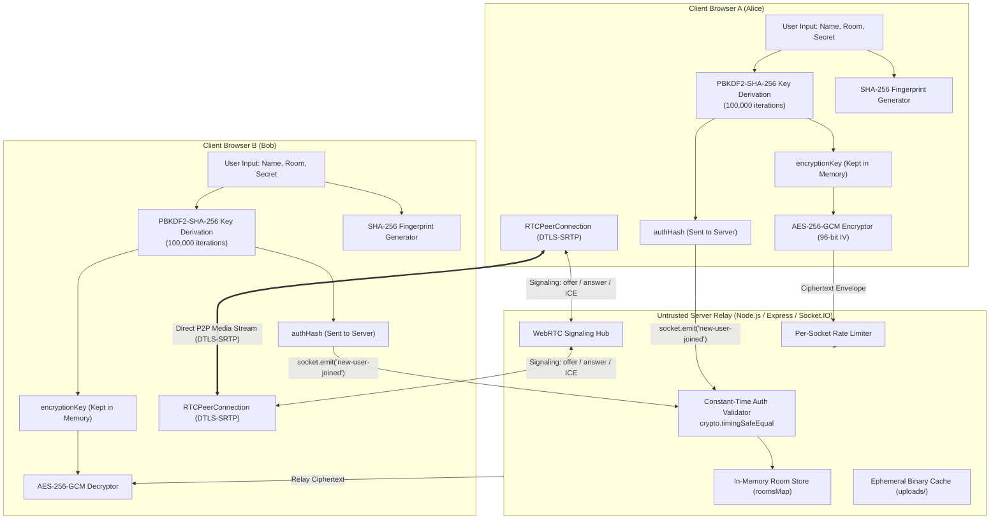
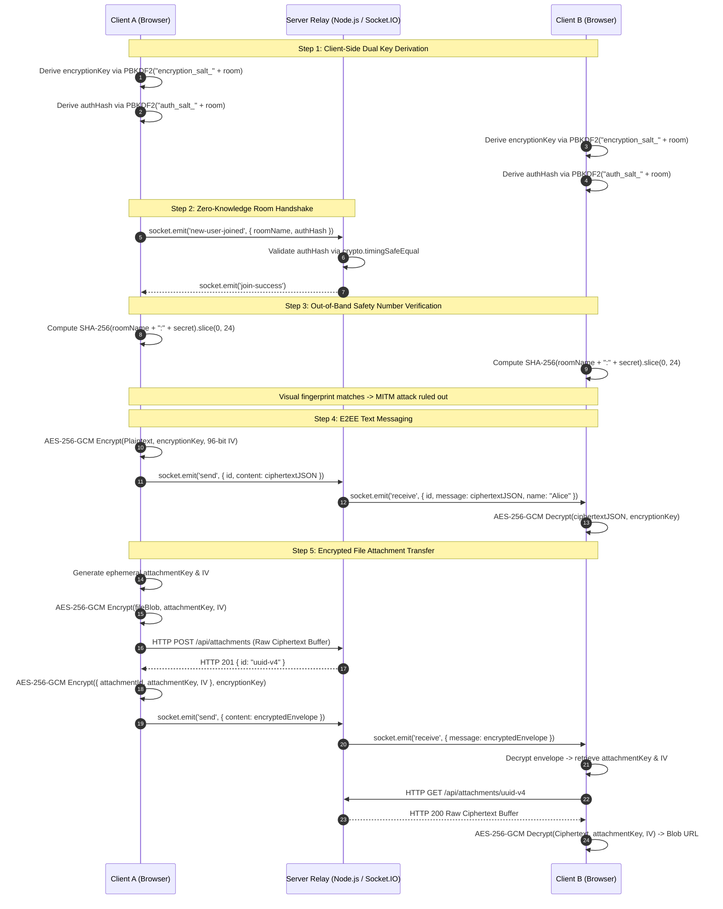

# NijiSamvad (निजी संवाद)

> **Zero-Knowledge, Zero-Database, End-to-End Encrypted (E2EE) Real-Time Messaging and WebRTC Multimedia Mesh Platform**

[](https://nodejs.org/)
[](https://react.dev/)
[](https://socket.io/)
[](https://webrtc.org/)
[](https://w3c.github.io/webcrypto/)
[](LICENSE)

---

## 1. Professional Project Introduction

**NijiSamvad** (Hindi: *निजी संवाद*, meaning *"Private Dialogue"*) is an enterprise-grade, zero-knowledge communication platform engineered from first principles for strictly ephemeral, cryptographically sovereign conversations. 

Unlike traditional collaboration tools (Slack, Teams, Discord) that retain chat transcripts and metadata in relational databases, and unlike centralized consumer messaging applications that require phone numbers, personal identifiers, or persistent cloud state, NijiSamvad operates with **absolute zero persistence**. 

Client devices derive symmetric encryption keys entirely in memory from client-generated high-entropy secrets. Plaintext, keys, and file contents never touch the network unencrypted and are never stored in a database or Redis cache. Once participants leave a room, all in-memory routing states and temporary encrypted binary buffers are irreversibly unlinked and destroyed.

---

## 2. Problem Statement

Modern digital communication infrastructure is burdened by systemic privacy vulnerabilities:

1. **Persistent Data Residue**: Databases, cloud backups, and disk journals turn casual conversations into perpetual legal and security liabilities.
2. **Key Custody Dilemma**: Many services claiming "encryption at rest" retain master decryption keys on their application servers, exposing user communications to subpoena, insider threats, and server breach compromise.
3. **Identity Tracking**: Mandatory registration via phone numbers, SMS OTPs, or email addresses irrevocably links user identities with social graphs and access logs.
4. **Heavyweight Media Middleware**: Traditional video calling architectures route media streams through Selective Forwarding Units (SFUs) or Multipoint Control Units (MCUs) that process or re-encode video packets, creating centralized interception vectors.

---

## 3. Solution Overview

NijiSamvad solves these challenges through a zero-trust, ephemeral architecture:

- **Client-Side Key Derivation (PBKDF2-SHA-256)**: 100,000 iterations derive distinct cryptographic keys for payload encryption (`encryptionKey`) and room gatekeeping (`authHash`). The encryption key never leaves the client's RAM.
- **Payload Confidentiality (AES-256-GCM)**: Every text message and attachment chunk is encrypted with native Web Crypto APIs using unique 96-bit Initialization Vectors (IVs). The backend functions strictly as an untrusted message relay.
- **Zero-Database Ephemerality**: Rooms exist solely as in-memory state machines within Node.js. When the last user disconnects, the room and all associated encrypted binary files are immediately deleted from disk and memory.
- **Direct P2P WebRTC Multimedia Mesh**: Video and audio streams are exchanged directly peer-to-peer using DTLS-SRTP encryption, bypassing server media processing entirely.

---

## 4. Key Features

### Security & Cryptography
- **AES-256-GCM End-to-End Encryption**: Authenticated symmetric encryption for both text payloads and binary attachments.
- **Zero-Knowledge Credential Separation**: The server only receives `authHash` for access validation and has zero mathematical capability to derive the `encryptionKey` or decrypt payloads.
- **Timing-Attack Immunity**: Credential verification employs Node.js `crypto.timingSafeEqual` to prevent side-channel timing attacks.
- **Visual Safety Fingerprints**: 24-character hexadecimal room fingerprints (e.g., `A1B2 C3D4 E5F6 7890 1234 5678`) derived via SHA-256 for out-of-band identity verification against Man-in-the-Middle (MITM) attacks.
- **Unbiased Entropy Generation**: Cryptographically secure room secret generator using rejection sampling across 68 characters to eliminate modulo bias ($68^{24} \approx 2^{146.1}$ bits of entropy).

### Real-Time Messaging & Collaboration
- **Encrypted Binary Attachments**: Up to 9.5 MB files encrypted client-side with independent single-use AES-256-GCM keys before transmission.
- **Interactive Contextual Replies**: Swipe-to-reply gesture on mobile, hover-to-reply on desktop, and reply-preview blocks that smoothly scroll to and highlight referenced messages.
- **Real-Time Mentions & Autocomplete**: `@username` detection with keyboard navigation (`Up`, `Down`, `Tab`, `Enter`) and highlighted tag rendering.
- **Zero-Asset Web Audio Synthesizer**: Programmatic chime generation via Web Audio API oscillators—no MP3 assets required.
- **Typing Indicators & Reactions**: Throttled live typing notifications and emoji reactions.
- **Offline Demo Mode**: Embedded client-side simulation bot ("Ada Lovelace") for instant zero-network cryptographic evaluation.

### WebRTC Multimedia Mesh Calling
- **Direct Peer-to-Peer Calling**: Multi-party mesh video/audio secured by DTLS-SRTP.
- **Explicit Call Signaling State Machine**: `call-invite`, `call-accept`, `call-decline`, `call-cancel`, and `call-ended` events with graceful fallback for late joiners.
- **Live Active Speaker Detection**: Web Audio API `AnalyserNode` monitoring real-time frequency spectra to trigger active speaker visual glow and soundwave equalizers.
- **Dynamic Presentation Layouts**: Seamless toggle between equal-ratio Grid mode and Speaker/Presentation mode with double-click tile pinning.
- **Native Screen Sharing**: Real-time track substitution across all active peer connections via `RTCRtpSender.replaceTrack()`.
- **Picture-in-Picture (PiP)**: Full support for Picture-in-Picture API, including automatic activation on browser tab backgrounding.

---

## 5. Technology Stack

### Frontend Architecture
| Layer | Technology | Version | Justification |
| :--- | :--- | :--- | :--- |
| **Framework** | React | `19.2.8` | Concurrent rendering, fine-grained state management, and modern component lifecycle |
| **Build Tool** | Vite | `8.2.2` | Lightning-fast HMR and optimized ES module bundling |
| **Icons** | Lucide React | `1.39.0` | Accessible, tree-shakeable SVG UI iconography |
| **Emoji Engine** | Emoji Picker React | `4.19.4` | Native client-side emoji catalog and selector |
| **Styling** | Vanilla Modern CSS | CSS3 Custom Properties | High-contrast Dark/Yellow glassmorphic aesthetic; zero runtime CSS-in-JS overhead |

### Backend & Infrastructure
| Layer | Technology | Version | Justification |
| :--- | :--- | :--- | :--- |
| **Runtime** | Node.js | `>= 18.0.0` (ES Modules) | High-performance non-blocking I/O and native buffer manipulation |
| **HTTP Framework** | Express | `5.2.1` | Minimalist routing, raw binary payload streaming, and error delegation |
| **WebSockets** | Socket.IO | `4.8.3` | Reliable bi-directional event transport with automatic WebSocket-to-polling fallback |
| **Security Headers** | Helmet | `8.3.0` | Production CSP, HSTS, X-Content-Type-Options, and frameguard isolation |
| **CORS** | CORS | `2.8.6` | Dynamic origin verification against environment-configured whitelist |
| **Cryptography** | Web Crypto API / Node `crypto` | Native | Hardware-accelerated AES-NI cryptographic primitives without third-party dependencies |

### Testing & Verification
| Tool | Version | Purpose |
| :--- | :--- | :--- |
| **Playwright** | `1.63.0` | Multi-browser end-to-end integration and media device emulation |
| **Oxlint** | `1.79.0` | High-speed static analysis and linting |
| **Custom Fuzzing Suite** | Native Node.js | 28 automated security, rate-limiting, and timing tests |

---

## 6. Architecture Overview & Request Lifecycle



### End-to-End Encryption Sequence



---

## 7. Project Structure

```
NijiSamvad/
├── .env.example                 # Template for environment configuration
├── .gitignore                   # Git exclusion rules
├── .oxlintrc.json               # Oxlint static analysis configuration
├── DEPLOYMENT.md                # Production hosting and reverse proxy guide
├── E2E_TESTING.md               # Playwright automated & manual testing manual
├── PERFORMANCE.md               # Load testing, memory benchmarks & scalability report
├── SECURITY.md                  # Comprehensive security policy & threat model
├── index.html                   # HTML entrypoint with metadata and CSP targets
├── package.json                 # Dependency manifest and execution scripts
├── playwright.config.js         # Playwright multi-browser test harness configuration
├── public/                      # Static assets served at root
│   ├── favicon.ico              # Favicon legacy format
│   ├── favicon.png              # High-DPI Favicon
│   ├── favicon.svg              # Scalable vector icon
│   ├── icons.svg                # Application SVG symbol sheet
│   ├── logo-icon.png            # Application emblem icon
│   └── logo.png                 # Brand logo banner
├── server/
│   └── server.js                # Express & Socket.IO server, auth engine & ephemeral storage
├── src/
│   ├── App.jsx                  # Main application state machine & lifecycle orchestrator
│   ├── index.css                # Design tokens, responsive styles, animations & theme rules
│   ├── main.jsx                 # React root mounting and Error Boundary provider
│   ├── assets/                  # Frontend graphic assets
│   ├── components/
│   │   ├── CallInterface.jsx    # WebRTC multi-peer video grid, pinning, PiP & audio visualizer
│   │   ├── ErrorBoundary.jsx    # React declarative error boundary
│   │   ├── Header.jsx           # App navigation bar, status badges & responsive menu
│   │   ├── IncomingCallModal.jsx# Audio/video call invitation dialog (Accept/Decline)
│   │   ├── JoinModal.jsx        # Credentials entry, secret generator & entropy validator
│   │   ├── MessageInput.jsx     # Input composer, auto-resizing, emoji picker & @mentions
│   │   ├── MessageList.jsx      # Virtualized message list, grouping, replies & date breaks
│   │   ├── SecurityModal.jsx    # Cryptographic safety number modal & room diagnostics
│   │   ├── Toast.jsx            # Toast alert notifications queue
│   │   ├── UserDrawer.jsx       # Active room participant roster sidebar
│   │   └── VideoPlayer.jsx      # Native HTML5 video component with autoplay handling
│   ├── hooks/
│   │   └── useWebRTC.js         # P2P WebRTC hook (Perfect Negotiation, track replace, queues)
│   └── services/
│       ├── crypto.js            # Web Crypto API routines (PBKDF2, AES-GCM, SHA-256, rejection)
│       └── sound.js             # Web Audio API procedural sound synthesizer
├── tests/
│   ├── e2e/                     # Playwright end-to-end integration test suites
│   │   ├── attachments.spec.js  # Binary file upload, download and decryption tests
│   │   ├── calls.spec.js        # Multi-peer WebRTC call invitation lifecycle tests
│   │   ├── core.spec.js         # Room isolation, valid/invalid secret verification tests
│   │   ├── media.spec.js        # Camera fallback & screen sharing tests
│   │   ├── messaging.spec.js    # Threaded replies and user mention autocomplete tests
│   │   └── resilience.spec.js   # XSS payload rejection & mobile viewport usability tests
│   ├── test-load.js             # High-concurrency socket and throughput stress harness
│   └── test-server.js           # 28-test server security, timing, fuzzing & lifecycle suite
└── vite.config.js               # Vite bundling & development reverse proxy configuration
```

---

## 8. Important Technical Implementations

### 1. Modulo-Unbiased Entropy Sampling
Standard pseudo-random generation using modulo arithmetic (`rand % length`) introduces mathematical bias if the alphabet length does not evenly divide the random number generator's word size ($2^{32}$). NijiSamvad implements rejection sampling to guarantee zero bias:

```javascript
// src/services/crypto.js
export const generateSecureRoomSecret = () => {
  const chars = 'ABCDEFGHIJKLMNOPQRSTUVWXYZabcdefghijklmnopqrstuvwxyz0123456789!@#$%^&*';
  const len = chars.length;
  const maxValid = 4294967296 - (4294967296 % len);
  let secret = '';
  const buffer = new Uint32Array(1);
  while (secret.length < 24) {
    crypto.getRandomValues(buffer);
    const val = buffer[0];
    if (val < maxValid) {
      secret += chars.charAt(val % len);
    }
  }
  return secret;
};
```

### 2. Dual-Salt PBKDF2 Key Separation
To maintain zero-knowledge properties, two distinct cryptographic outputs are derived from a single room secret:

$$\text{encryptionKey} = \text{PBKDF2}(\text{secret}, \text{"encryption\_salt\_"} + \text{roomName}, 100000, \text{SHA-256})$$
$$\text{authHash} = \text{PBKDF2}(\text{secret}, \text{"auth\_salt\_"} + \text{roomName}, 100000, \text{SHA-256})$$

The `encryptionKey` is imported directly into the non-extractable WebCrypto keystore in client memory. The server receives solely `authHash`.

### 3. Timing-Safe Credential Verification
To eliminate timing side-channel attacks during room joins and attachment retrievals, room credential validation runs in constant time:

```javascript
// server/server.js
validateCredential(roomName, authHash) {
  const room = roomsMap.get(roomName);
  if (!room) return false;
  if (!room.authHash) return true;
  if (typeof authHash !== 'string' || typeof room.authHash !== 'string') return false;
  if (authHash.length === 0 || authHash.length > LIMITS.AUTHHASH) return false;
  
  const bufA = Buffer.from(room.authHash);
  const bufB = Buffer.from(authHash);
  if (bufA.length !== bufB.length) return false;
  return crypto.timingSafeEqual(bufA, bufB);
}
```

### 4. Dynamic WebRTC Track Replacement
Screen sharing does not renegotiate the entire SDP offer/answer cycle. Instead, it utilizes `RTCRtpSender.replaceTrack()` to seamlessly substitute video tracks with zero call interruption:

```javascript
// src/hooks/useWebRTC.js
const displayStream = await navigator.mediaDevices.getDisplayMedia({ video: true });
const displayTrack = displayStream.getVideoTracks()[0];

for (const peerId of Object.keys(peersRef.current)) {
  const peer = peersRef.current[peerId];
  if (peer) {
    const videoSender = peer.getSenders().find(s => s.track && s.track.kind === 'video');
    if (videoSender) {
      await videoSender.replaceTrack(displayTrack);
    }
  }
}
```

---

## 9. Zero-Database Architecture & Data Teardown

NijiSamvad deliberately avoids SQL/NoSQL databases. Room state and metadata reside strictly in memory using native JavaScript `Map` collections:

- `roomsMap`: Stores `{ authHash, users: Map(socketId -> { id, username, joinedAt }) }`.
- `attachmentMeta`: Stores `{ roomId, filePath, createdAt }`.
- `rateLimitsMap`: Stores per-socket sliding-window action counters.

### Ephemeral Teardown Guarantees
1. **Room Vacancy Trigger**: When the last socket leaves a room, `destroyRoomIfEmpty(roomName)` executes immediately:
   - All attachment binary files associated with the room are unlinked via `fs.promises.unlink()`.
   - The room entry is evicted from `roomsMap`.
2. **Boot Wipe**: The server wipes and recreates the `uploads/` directory on cold boot.
3. **Graceful Shutdown**: Intercepting `SIGTERM` and `SIGINT` triggers synchronous eviction of all socket connections and purges `uploads/`.
4. **Hourly Orphan Sweeper**: A scheduled interval deletes any attachment exceeding a 24-hour TTL or belonging to an evicted room.

---

## 10. Security & Performance Audits

### Security Guarantees
- **Zero Plaintext Transmission**: Messages are encrypted prior to network serialization.
- **Server Blindness**: Server administrators inspecting network traffic or memory dumps see only random ciphertext and PBKDF2 hashes.
- **Strict Content Security Policy**: Helmet-enforced CSP prevents code execution and unauthorized script sourcing.

### Verified Benchmark Metrics
Performance testing conducted on Node.js v24 (Linux 64-bit, 1 vCPU, 1 GB RAM):

| Benchmark Scenario | Metric | Result |
| :--- | :--- | :--- |
| **Idle Server Memory Footprint** | RSS | **~75 MB** |
| **50 Concurrent Sockets Handshake** | Latency | **202 ms** (RSS: 85 MB) |
| **50-User Room Message Fan-out** | Throughput | **4,900 deliveries / 2,000 ms (~2,450 msgs/s total fan-out)** |
| **10 Concurrent 1 MB File Uploads** | Throughput | **~135 MB/s** (Disk I/O bounded) |
| **Post-Disconnect Memory Cleanup** | Leak Assessment | **Zero memory leaks; RSS stabilized to baseline** |

---

## 11. Installation & Local Development

### Prerequisites
- **Node.js**: Version `18.0.0` or higher
- **npm**: Version `9.0.0` or higher

### 1. Clone the Repository
```bash
git clone https://github.com/tanmay9783/NijiSamvad.git
cd NijiSamvad
```

### 2. Install Dependencies
```bash
npm install
```

### 3. Configure Environment Variables
Copy `.env.example` to `.env`:
```bash
cp .env.example .env
```

### 4. Run Development Servers
Start both the Express backend and the Vite frontend concurrently:
```bash
npm run dev:full
```
- **Frontend**: `http://localhost:5173`
- **Backend API & WebSockets**: `http://localhost:5000`

---

## 12. Environment Variable Configuration

| Variable | Type | Default | Description |
| :--- | :--- | :--- | :--- |
| `PORT` | Integer | `5000` | Port for Express HTTP & Socket.IO server |
| `NODE_ENV` | String | `development` | Set to `production` to activate strict CSP, HSTS, and CORS enforcement |
| `CLIENT_ORIGIN` | URL | `http://localhost:5173` | Explicit whitelist origin allowed for CORS handshakes |
| `VITE_API_URL` | URL | *(empty / relative)* | Backend URL baked into production client build for CDN hosting |
| `ENABLE_LOAD_METRICS` | Boolean | `false` | When `true`, exposes `/api/stats` and `/debug/metrics` |

---

## 13. Production Deployment

NijiSamvad is optimized for deployment as a single-container service or paired across a static CDN (Vercel) and a container host (Render, Fly.io, Railway, VPS).

### Recommended Single-Instance VPS Deployment
```bash
# 1. Build optimized frontend production bundle
npm run build

# 2. Start server in production mode
npm start
```

### Nginx Reverse Proxy with TLS/WSS Termination
Because WebCrypto and WebRTC require secure origins (`https://`), production deployments must sit behind an SSL-terminating reverse proxy:

```nginx
server {
    listen 443 ssl http2;
    server_name chat.yourdomain.com;

    ssl_certificate /etc/letsencrypt/live/chat.yourdomain.com/fullchain.pem;
    ssl_certificate_key /etc/letsencrypt/live/chat.yourdomain.com/privkey.pem;

    client_max_body_size 12M;

    location / {
        proxy_pass http://127.0.0.1:5000;
        proxy_http_version 1.1;
        proxy_set_header Upgrade $http_upgrade;
        proxy_set_header Connection "upgrade";
        proxy_set_header Host $host;
        proxy_set_header X-Real-IP $remote_addr;
        proxy_set_header X-Forwarded-For $proxy_add_x_forwarded_for;
        proxy_set_header X-Forwarded-Proto $scheme;
    }
}
```

---

## 14. Automated Testing & Verification Suite

The repository contains comprehensive automated test suites covering unit security, E2E browser flows, and performance load:

```bash
# 1. Run 28 Server Security, Cryptographic & Fuzzing Tests
node tests/test-server.js

# 2. Run Playwright End-to-End User Journey Tests
npm run test:e2e

# 3. Run Socket Concurrency & Fan-Out Load Tests
npm run test:load

# 4. Run Code Quality Static Analysis
npm run lint

# 5. Verify Production Build
npm run build
```

---

## 15. API & WebSocket Protocol Reference

### HTTP REST Endpoints

#### `GET /health`
- **Description**: Heartbeat check for container orchestrators.
- **Response**: `200 OK` `{"status": "alive", "uptime": 124.5}`

#### `POST /api/attachments`
- **Headers**:
  - `Content-Type: application/octet-stream`
  - `x-room-name: <roomName>`
  - `x-auth-hash: <authHash>`
- **Body**: Raw binary ciphertext (Max 10 MB).
- **Response**: `201 Created` `{"id": "c7a8b3d0-..."}`

#### `GET /api/attachments/:id`
- **Headers**:
  - `x-room-name: <roomName>`
  - `x-auth-hash: <authHash>`
- **Response**: `200 OK` Binary ciphertext stream (`Cache-Control: no-store`).

### Socket.IO Event Signatures

| Event Name | Direction | Payload Structure | Description |
| :--- | :--- | :--- | :--- |
| `new-user-joined` | Client $\to$ Server | `{ userName, roomName, authHash }` | Authenticates socket into room |
| `join-success` | Server $\to$ Client | `{ username, room }` | Confirms room admission |
| `join-error` | Server $\to$ Client | `string` | Reports authentication failure |
| `send` | Client $\to$ Server | `{ id, content }` | Broadcasts ciphertext to room peers |
| `receive` | Server $\to$ Client | `{ id, message, name, timestamp }` | Dispatches ciphertext to recipients |
| `typing` | Client $\to$ Server | `boolean` | Throttled typing indicator |
| `user-typing` | Server $\to$ Client | `{ user, isTyping }` | Relays typing status to room |
| `webrtc-offer` | Bi-directional | `{ targetSocketId, sdp }` | Relays WebRTC SDP offer |
| `webrtc-answer` | Bi-directional | `{ targetSocketId, sdp }` | Relays WebRTC SDP answer |
| `webrtc-ice-candidate`| Bi-directional | `{ targetSocketId, candidate }` | Relays ICE candidate |
| `call-invite` | Client $\to$ Server | *(none)* | Broadcasts call ringing to room |
| `call-accept` | Client $\to$ Server | `{ targetSocketId }` | Notifies caller of call acceptance |
| `call-decline` | Client $\to$ Server | `{ targetSocketId }` | Notifies caller of call rejection |
| `call-ended` | Client $\to$ Server | *(none)* | Broadcasts call termination |

---

## 16. Future Roadmap

- [ ] **Ratchet Protocol Implementation**: Upgrade from single-session PBKDF2 keys to a client-side Double Ratchet (Signal protocol) for forward and backward secrecy.
- [ ] **Selective Forwarding Unit (SFU) Sidecar**: Add an optional end-to-end encrypted SFU (e.g., via WebRTC Insertable Streams / SFrame) to scale video calls beyond 8 participants without client CPU bottlenecks.
- [ ] **WebAuthn Biometric Locks**: Allow users to lock client-side local session caches using WebAuthn / Passkeys.
- [ ] **Tor Onion Service Gateway**: Provide direct .onion configuration scripts for censorship-resistant anonymous routing.

---

## 17. Contributing Guidelines

1. **Fork the Repository**: Create a feature branch (`git checkout -b feature/crypto-enhancement`).
2. **Maintain Security Invariants**: Never compromise the zero-knowledge model. All cryptographic primitives must execute exclusively in client memory.
3. **Add Tests**: Accompany every functional change with a test in `tests/test-server.js` or `tests/e2e/`.
4. **Code Quality**: Ensure `npm run lint` and `node tests/test-server.js` pass with zero errors.
5. **Open Pull Request**: Detail the architectural justification, performance implications, and threat model impact.

---

## 18. Author & Engineering Credits

**Tanmay**  
*Software Engineer & Architect*  
- **GitHub**: [@tanmay9783](https://github.com/tanmay9783)  
- **Repository**: [https://github.com/tanmay9783/NijiSamvad](https://github.com/tanmay9783/NijiSamvad)
